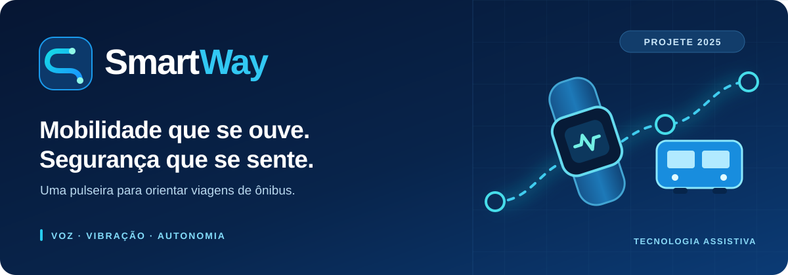
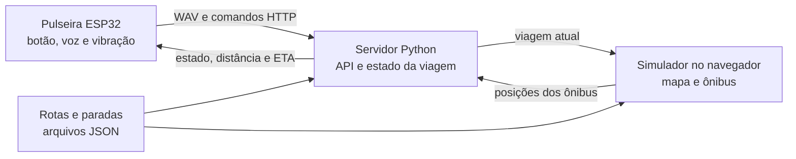

<p align="center">
  
</p>

<p align="center">
  Orientação por voz e vibração para viagens de ônibus.<br>
  Um projeto do <strong>Grupo 2202</strong>, desenvolvido para a <strong>PROJETE 2025</strong>.
</p>

<p align="center">
  
  
  
  <a href="LICENSE"></a>
</p>

<p align="center">
  <a href="#projeto">Conheça o projeto</a> ·
  <a href="#fluxo">Acompanhe a viagem</a> ·
  <a href="#arquitetura">Entenda a arquitetura</a> ·
  <a href="#execucao">Execute o protótipo</a> ·
  <a href="#arquivos">Explore os arquivos</a>
</p>

---

<a id="projeto"></a>

## O ônibus certo, no momento certo

Em um ponto movimentado, identificar o ônibus que se aproxima e saber quando descer pode depender de ajuda de outras pessoas. O **SmartWay** foi criado para orientar pessoas com deficiência visual nesses momentos por meio de uma pulseira com **um botão, mensagens de áudio e padrões de vibração**.

O usuário informa origem e destino por voz. Durante a viagem, a pulseira recebe do servidor o estado do trajeto e avisa quando o ônibus se aproxima do embarque ou do desembarque. Um simulador em mapa fornece as posições dos ônibus usadas nesta versão do projeto.

| Pergunta durante a viagem | Resposta do protótipo |
| --- | --- |
| **“Como informo para onde quero ir?”** | Segure o botão e fale a origem; repita para o destino. |
| **“Qual ônibus devo esperar?”** | O servidor procura uma linha que passe pelos dois pontos na ordem correta e associa um ônibus simulado à viagem. |
| **“Quando preciso me preparar?”** | Áudio e vibração sinalizam a aproximação do ônibus e do destino. |
| **“Como encerro a viagem?”** | Um clique duplo solicita o cancelamento. |

<a id="fluxo"></a>

## Da fala ao aviso

1. **Iniciar.** Um clique único solicita uma nova viagem. A bateria é lida nesse momento; tensão de 3,3 V ou menos gera aviso, sem bloquear o início.
2. **Definir.** Ao segurar o botão, a pulseira grava até quatro segundos de áudio e envia um WAV ao servidor. O processo se repete para origem e destino.
3. **Encontrar a rota.** O servidor transcreve a fala com Whisper, procura os nomes e apelidos das paradas e seleciona uma linha válida.
4. **Acompanhar.** O simulador publica as posições dos ônibus. O servidor calcula distância e ETA; a pulseira consulta o estado a cada dois segundos.
5. **Avisar.** Faixas de áudio e pulsos de vibração marcam a aproximação, o embarque, o percurso e a chegada.

O clique longo grava a voz, o clique único inicia e o duplo cancela. A [tabela de gestos e faixas](firmware/README.md) mostra os tempos e os avisos implementados.

<a id="arquitetura"></a>

## Três partes, uma viagem



| Parte | Papel | Onde ler mais |
| --- | --- | --- |
| **Pulseira** | Lê o botão e o microfone I2S; reproduz áudio pelo DFPlayer Mini e aciona o motor de vibração. | [Firmware](firmware/README.md) |
| **Servidor** | Transcreve a voz, identifica paradas, calcula rota e ETA e mantém o estado da viagem em memória. | [Software](software/README.md) |
| **Simulador** | Desenha quatro linhas no mapa, move ônibus e envia as posições ao servidor. | [Software](software/README.md) |
| **Placa e case** | Layout da PCB, esquemático documental alinhado a ela e duas peças STL da caixa. | [Hardware](hardware/README.md) |

**O rastreamento desta versão vem do simulador.** Não há integração com GPS ou dados de uma frota real. O servidor mantém a viagem somente em memória; reiniciá-lo encerra o acompanhamento em curso.

<a id="execucao"></a>

## Execute o protótipo

Os comandos abaixo são para **PowerShell no Windows**. O servidor espera encontrar os JSONs no diretório atual, por isso deve ser iniciado de dentro de `software/`.

### 1. Prepare o Python

Use Python 3.11, instale FFmpeg no sistema e confirme que o comando `ffmpeg` está disponível no terminal. As versões exatas das bibliotecas do projeto original não foram registradas.

```powershell
py -3.11 -m venv .venv
.\.venv\Scripts\python.exe -m pip install -r .\software\requirements.txt
```

### 2. Inicie o servidor

```powershell
cd .\software
..\.venv\Scripts\python.exe .\servidor.py
```

O servidor carrega o modelo Whisper `small` e atende na porta **5000**. A primeira carga do modelo pode exigir download.

### 3. Sirva o simulador

Em outro terminal, na **raiz do repositório**:

```powershell
.\.venv\Scripts\python.exe -m http.server 8000 --directory .\software
```

Abra `http://localhost:8000/simulador.html` e inicie a simulação. O HTML precisa ser servido por HTTP para carregar os três JSONs locais.

### 4. Conecte a pulseira

O firmware depende de uma placa ESP32 compatível, microfone I2S, DFPlayer Mini com cartão SD, botão, LED e motor de vibração. Instale o suporte ESP32 no Arduino IDE e as bibliotecas **ArduinoJson** e **DFRobotDFPlayerMini**. Os arquivos MP3 das quinze mensagens não vieram com o material recebido.

O firmware e o simulador contêm um IP fixo do servidor; o firmware também contém as credenciais da rede usada no protótipo. Esses valores precisam corresponder à rede da demonstração. Veja os [pinos e dependências](firmware/README.md) e os [detalhes do servidor](software/README.md).

<a id="arquivos"></a>

## Explore os arquivos

| Pasta ou arquivo | Conteúdo |
| --- | --- |
| [`firmware/`](firmware/README.md) | Código Arduino da pulseira e guia de operação. |
| [`software/`](software/README.md) | API, simulador, dados de rotas e dependências Python. |
| [`hardware/`](hardware/README.md) | Layout EAGLE, esquemático corrigido e peças STL do case. |
| [`docs/GUIA_DO_CODIGO.md`](docs/GUIA_DO_CODIGO.md) | Funções, estados e rotas HTTP em detalhe. |
| [`LICENSE`](LICENSE) | Condições proprietárias de uso. |

Os arquivos da PCB e do case registram o protótipo **já construído em 2025**. O esquemático incluído foi reconstruído depois a partir do layout: sua lista de componentes e redes foi comparada com o `.brd`, mas ele não foi reaberto em um editor EAGLE/Fusion.

### Publicação e licença

O código e os materiais próprios do projeto estão sob [licença proprietária](LICENSE). Bibliotecas e imagens externas mantêm as condições de seus titulares.

O [firmware](firmware/codigo-oficial/codigo-oficial.ino) contém uma senha Wi-Fi escrita diretamente no código. **Antes de publicar o repositório de forma pública, confirme que a credencial antiga foi desativada ou remova-a de uma cópia destinada à publicação.** O `.gitignore` não oculta conteúdo de arquivos rastreados.
