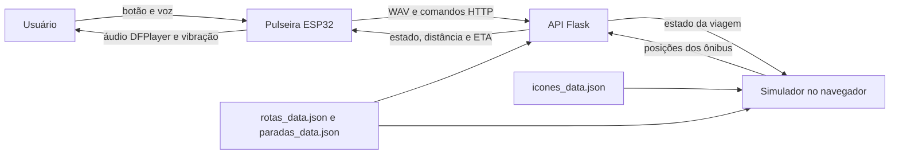

# SmartWay

<p align="center">Uma pulseira para orientar viagens de ônibus com voz e vibração.<br>Um projeto do <strong>Grupo 2202</strong>, desenvolvido para a <strong>PROJETE 2025</strong>.</p>

<p align="center">
  
  
  
  <a href="LICENSE"></a>
</p>

**O SmartWay orienta pessoas com deficiência visual em viagens de ônibus por voz e vibração.**

O usuário inicia uma viagem com um botão, fala a origem e o destino, recebe avisos enquanto o ônibus simulado se aproxima e é alertado para embarcar e desembarcar. O protótipo une firmware para ESP32, uma API Python e um simulador de linhas em um mapa. A interface da pulseira é não visual; o mapa permite acompanhar e demonstrar o funcionamento.

> **Escopo desta versão:** as posições dos ônibus vêm do simulador incluído no projeto. O código não contém uma integração com a frota real de uma operadora. O layout da PCB, um esquemático corrigido e as duas peças do case estão em [`hardware/`](hardware/README.md); os arquivos MP3 usados pelo DFPlayer Mini não estão na pasta.

## Como a viagem acontece

1. Um clique único solicita uma viagem ao servidor. A pulseira mede a bateria e avisa em áudio se a tensão está em 3,3 V ou menos, sem impedir o início.
2. O usuário segura o botão para gravar a origem e repete o gesto para gravar o destino. A pulseira monta o WAV e envia o áudio à API.
3. O servidor transcreve a fala com Whisper, encontra uma parada por seus apelidos e escolhe uma linha que passe pela origem antes do destino.
4. O simulador envia as posições dos ônibus. O servidor associa um ônibus à viagem, calcula distância e ETA e muda o estado conforme ele percorre a rota.
5. A pulseira consulta o estado a cada 2 segundos e responde com áudio e vibração. Um clique duplo cancela a viagem.



## O que há no repositório

```text
.
├── firmware/
│   └── codigo-oficial/
│       └── codigo-oficial.ino    # Programa da pulseira (pasta com o nome exigido pelo Arduino)
├── software/
│   ├── servidor.py               # API, transcrição e regras da viagem
│   ├── simulador.html            # Mapa, ônibus e painel de demonstração
│   ├── rotas_data.json           # Traçados, paradas e horários por linha
│   ├── paradas_data.json         # Nomes, apelidos, referências e coordenadas
│   ├── icones_data.json          # URLs e tamanhos dos ícones do mapa
│   └── requirements.txt          # Dependências Python declaradas pelo código
├── docs/
│   └── GUIA_DO_CODIGO.md         # Funções, estados, dados e integração em detalhe
├── hardware/
│   ├── pulseira2202.brd          # Layout da PCB no Autodesk EAGLE
│   ├── pulseira2202.sch          # Esquemático corrigido para a placa
│   ├── pulseira_2202_base.stl    # Peça base do case
│   ├── pulseira_2202_topo.stl    # Peça topo do case
│   └── README.md                 # Inspeção e ligação com o firmware
├── assets/
│   ├── banner-smartway.svg       # Identidade visual do README
│   └── badges/                  # Etiquetas quadradas, sem serviço externo
├── .gitignore
├── LICENSE
└── README.md
```

As exportações recebidas tinham cópias repetidas. A comparação por SHA-256 mostrou que os arquivos de código e os três JSONs eram iguais entre essas cópias; a estrutura acima usa uma delas como fonte. Ambientes `venv`, gravações e históricos de execução não fazem parte dos arquivos preparados para o Git.

## Componentes e responsabilidades

| Componente | Responsabilidade | Principais ligações |
| --- | --- | --- |
| ESP32 e `codigo-oficial.ino` | Lê o botão, captura áudio I2S, consulta a API e aciona DFPlayer, vibração e LED. | Wi-Fi e HTTP com o servidor. |
| `servidor.py` | Mantém a viagem em memória, transcreve fala, identifica paradas, escolhe linha e ônibus e calcula ETA. | Recebe áudio da pulseira e posições do simulador. |
| `simulador.html` | Exibe mapa, linhas e horários; move ônibus e publica suas posições. | Lê os JSONs locais e conversa com a API. |
| JSONs de dados | Definem quatro linhas (vermelha, verde, rosa e amarela), paradas e ícones. | Devem ficar ao lado de `servidor.py` e `simulador.html`. |

O servidor armazena o estado apenas em memória: reiniciá-lo perde a viagem em andamento. O simulador também é parte necessária da demonstração; se ele deixa de atualizar as posições por mais de 15 segundos, o servidor encerra uma viagem ativa.

## Coloque o protótipo para funcionar

### 1. Prepare as dependências

- Python 3.11 é uma escolha compatível com o ambiente antigo encontrado na exportação. Instale FFmpeg no sistema para o Whisper e confirme que `ffmpeg` está disponível no terminal.
- Instale o suporte à placa ESP32 no Arduino IDE, além das bibliotecas **ArduinoJson** e **DFRobotDFPlayerMini**. A versão específica dessas bibliotecas não foi registrada no projeto original.
- Para o hardware completo, use ESP32, microfone I2S, DFPlayer Mini com cartão SD e arquivos de áudio, motor de vibração, botão e circuito de leitura da bateria. Confira os pinos no guia do código antes de ligar os componentes.
- O mapa depende de Leaflet, OpenStreetMap, Google Fonts e imagens hospedadas externamente; é necessária conexão com a internet para carregar esses recursos.

No PowerShell, a partir da raiz do repositório:

```powershell
py -3.11 -m venv .venv
.\.venv\Scripts\python.exe -m pip install -r .\software\requirements.txt
```

As dependências estão listadas sem versões fixas porque as exportações não trouxeram um ambiente executável nem um registro confiável das versões usadas. A instalação atual não foi validada como reprodução exata do ambiente de 2025.

### 2. Inicie a API

Em um terminal, entre em `software/` antes de executar o servidor: ele abre `rotas_data.json` e `paradas_data.json` por caminhos relativos.

```powershell
cd .\software
..\.venv\Scripts\python.exe .\servidor.py
```

O processo carrega o modelo Whisper `small` e escuta na porta **5000** em todas as interfaces de rede. A primeira carga do modelo pode exigir um download. Mantenha o terminal aberto.

### 3. Abra o simulador

Em outro terminal, a partir da raiz do repositório:

```powershell
.\.venv\Scripts\python.exe -m http.server 8000 --directory .\software
```

Abra `http://localhost:8000/simulador.html`, escolha uma linha e inicie a simulação. O navegador precisa servir o HTML por HTTP para que ele carregue os três JSONs; abrir o arquivo diretamente pelo explorador pode impedir o `fetch`.

### 4. Prepare a pulseira e a rede

Abra `firmware/codigo-oficial/codigo-oficial.ino` no Arduino IDE e grave no ESP32 correspondente ao circuito. O firmware e o simulador contêm um **endereço IP fixo do servidor**, e o firmware contém as credenciais de uma rede Wi-Fi antiga. Para executar em outra rede, esses valores precisam apontar para o computador e a rede usados na demonstração. Não os alterei nesta organização para preservar o código funcional recebido.

O servidor, o navegador e a pulseira precisam alcançar o mesmo computador pela rede. O simulador só fornece posições depois que a simulação está rodando. Os quinze áudios esperados pelo firmware não estão nesta pasta; prepare o cartão SD conforme os números definidos no arquivo `.ino`.

## Botão, respostas e estados

| Gesto | Ação |
| --- | --- |
| Clique único, confirmado após 750 ms | Mede a bateria e chama `POST /iniciar_viagem`. |
| Segurar por 500 ms ou mais e soltar | Grava até 4 segundos e envia WAV a `POST /comando_de_voz`. |
| Clique duplo dentro de 750 ms | Chama `GET /cancelar_viagem`. |

O servidor inicia em `IDLE`, passa por `AGUARDANDO_ORIGEM` e `AGUARDANDO_DESTINO`, pode pedir `REPETIR_ORIGEM` ou `REPETIR_DESTINO` e, após achar uma rota, avança por `MONITORANDO`, `AGUARDANDO_EMBARQUE`, `EM_VIAGEM` e `CHEGOU_AO_DESTINO`. Estados `FINALIZADO_*` registram o encerramento ou erro. Já `IDLE`, `RECORDING`, `UPLOADING` e `MONITORING` são **estados internos da pulseira**, com outra finalidade.

O alerta antecipado no firmware é acionado uma vez quando o ETA entra na faixa de **3 a 7 minutos** e outro quando chega a **2 minutos ou menos**, tanto na aproximação da origem quanto do destino. A chegada ao ponto e ao destino também têm alertas próprios. A tabela completa de áudios, vibrações e rotas HTTP está no [guia do código](docs/GUIA_DO_CODIGO.md).

## Antes de publicar no GitHub

O firmware recebido contém credenciais Wi-Fi escritas diretamente no código. **Revogue ou troque essas credenciais antes de tornar o repositório público** e decida como fornecer configuração local sem publicá-la. O `.gitignore` impede que ambientes, gravações e registros antigos entrem no Git, mas não oculta texto dentro de arquivos de código rastreados.

Este repositório organiza e documenta o protótipo original; nenhuma regra de funcionamento foi modificada. Os arquivos do projeto são disponibilizados sob [licença proprietária](LICENSE). A inspeção do layout e do case está em [hardware/](hardware/README.md).
